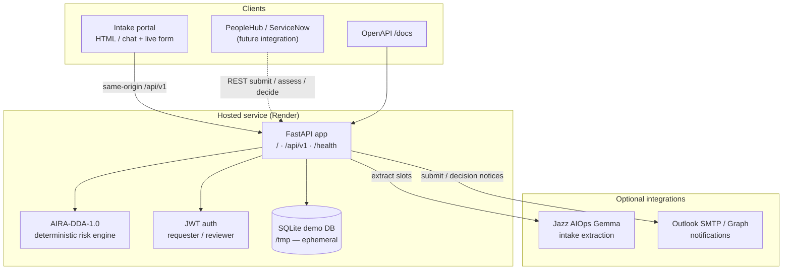
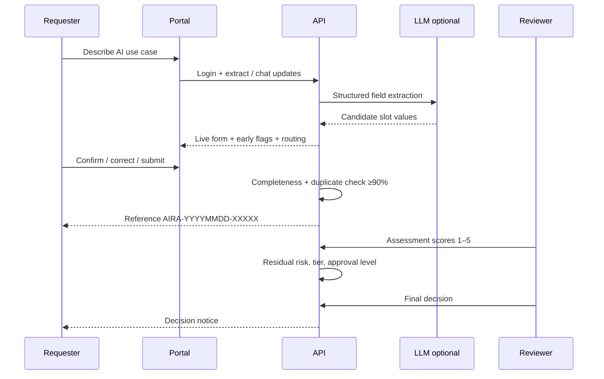

# Jazz AI Risk Assessment (AIRA)

Conversational AI use-case intake and residual-risk assessment for JazzWorld’s Responsible AI Office (RAIO). Requesters describe an AI idea in chat; the system extracts structured fields, runs duplicate checks, routes reviewers, and supports official **AIRA-DDA-1.0** scoring and decisions.

Designed for integration with Jazz **PeopleHub / ServiceNow**, with a clear API boundary so the portal UI and enterprise workflows can evolve independently.

---

## Live demo

| | |
| --- | --- |
| **Application** | [https://jazz-ai-risk-assessment.onrender.com](https://jazz-ai-risk-assessment.onrender.com) |
| **API docs** | [https://jazz-ai-risk-assessment.onrender.com/docs](https://jazz-ai-risk-assessment.onrender.com/docs) |
| **Health** | [https://jazz-ai-risk-assessment.onrender.com/health](https://jazz-ai-risk-assessment.onrender.com/health) |

> Free Render tier may sleep when idle; the first request after idle can take 30–60 seconds.

### Demo accounts

Password for all demo users: `JazzDemo-2026`

| Email | Role |
| --- | --- |
| `ayesha.khan@jazz.example` | Requester |
| `rahim.qureshi@jazz.example` | RAIO reviewer |
| `sana.malik@jazz.example` | Governance & Compliance |

---

## Architecture



### Request lifecycle



### High-level components

| Layer | Responsibility |
| --- | --- |
| **Portal** (`Ai_risk_assessment_icon_toggle.html`) | Conversational intake, live summary panel, indicative PDF, submit |
| **API** (`backend/app`) | Auth, sessions, submissions, assessment, decision, mail probes |
| **Intake** | Slot catalog, keyword + LLM extraction, duplicate similarity |
| **Methodology** | Official AIRA-DDA-1.0 scoring (LLM never sets the official score) |
| **Mail** | Graph / SMTP / log providers for requester + governance notices |

---

## Features

- Conversational intake with **live form updates** from chat intent  
- Categories: **AI For Us**, **AI By Us**, **AI Against Us**  
- Business-value fields (segment, value driver, cost / ROI / hours)  
- Screening triggers: sensitive data, decision influence, action/autonomy  
- Cross-submission **similarity index** (block at **90%**)  
- Indicative residual-risk preview + governance PDF  
- Official reviewer assessment and decision APIs  
- AIMS-oriented sample payload template for ServiceNow alignment  

---

## Repository layout

```text
.
├── Ai_risk_assessment_icon_toggle.html   # Intake portal UI
├── aims_payload_template.json            # AIMS integration sample contract
├── sample_intake_payloads.json           # Field catalog + example payloads
├── Dockerfile                            # Production image (portal + API)
├── render.yaml                           # Render Blueprint
├── RENDER.md                             # Hosting notes
└── backend/
    ├── app/
    │   ├── api/                          # HTTP routes
    │   ├── intake/                       # Slots, LLM, duplicates
    │   ├── methodology/                  # AIRA-DDA-1.0 engine
    │   ├── mail/                         # Notification providers
    │   ├── services/                     # Intake + submissions
    │   └── main.py                       # App entry (serves portal + API)
    ├── tests/
    ├── requirements.txt
    └── .env.example
```

---

## Developer documentation

### Prerequisites

- Python **3.11+**
- Optional: access to Jazz AIOps Gemma endpoint for live extraction  

### Local setup

```bash
git clone https://github.com/HamzaSattar9822/Jazz-AI-Risk-Assessment.git
cd Jazz-AI-Risk-Assessment/backend

python3 -m venv .venv
source .venv/bin/activate          # Windows: .venv\Scripts\activate
pip install -r requirements.txt -r requirements-dev.txt
cp .env.example .env

uvicorn app.main:app --reload --host 127.0.0.1 --port 8000
```

Open:

- Portal: http://127.0.0.1:8000/  
- API docs: http://127.0.0.1:8000/docs  
- Health: http://127.0.0.1:8000/health  

Alternatively, serve the HTML on port **8080** and point it at the API on **8000** (the portal auto-detects this).

### Configuration

Copy `backend/.env.example` → `backend/.env`. Important variables:

| Variable | Purpose |
| --- | --- |
| `DATABASE_URL` | Default `sqlite:///./aira.db` |
| `JWT_SECRET` | **Change** before any shared environment |
| `CORS_ORIGINS` | Comma-separated allowed origins |
| `DUPLICATE_THRESHOLD` | Default `90` |
| `LLM_BASE_URL` / `LLM_MODEL` | Jazz Gemma extraction |
| `MAIL_PROVIDER` | `auto` \| `log` \| `smtp` \| `graph` |
| `GOVERNANCE_EMAIL` | Governance notice recipient |

### Tests

```bash
cd backend
source .venv/bin/activate
pytest -q
```

### Core API surface

Base path: `/api/v1`

| Method | Path | Auth | Purpose |
| --- | --- | --- | --- |
| `POST` | `/auth/login` | — | Login (cookie + bearer token) |
| `GET` | `/auth/me` | user | Current user |
| `POST` | `/intake/extract` | user | Extract fields from text |
| `POST` | `/intake/sessions` | user | Start conversational session |
| `POST` | `/intake/sessions/{id}/messages` | user | Chat turn (updates slots) |
| `POST` | `/intake/sessions/{id}/submit` | user | Submit intake session |
| `POST` | `/submissions` | user | Portal / AIMS-style submit |
| `GET` | `/submissions` | user | List requests |
| `GET` | `/submissions/{referenceId}` | user | Get one request |
| `POST` | `/submissions/{referenceId}/assessment` | reviewer | Save risk scores |
| `POST` | `/submissions/{referenceId}/decision` | reviewer | Final decision |
| `GET` | `/methodology` | user | Factor schema |
| `POST` | `/methodology/assess` | reviewer | Official calculator |

Interactive reference: `/docs` on any running instance.

### Screening & risk outputs

Screening fields use **`"Yes"` / `"No"` strings** (not booleans):

```json
"screening": {
  "data": "Yes",
  "decision": "No",
  "action": "Yes"
}
```

After assessment, residual risk drives:

| Residual score | Tier | Severity | Typical approval |
| --- | --- | --- | --- |
| 1–25 | Tier 1 | Low | Self-Review |
| 26–59 | Tier 2 | Medium | Line Manager |
| 60–79 | Tier 3 | High | HoD / Function |
| 80–100 | Tier 4 | Critical | C-Suite |

Official scores are produced only by the deterministic engine after human-confirmed factor inputs.

### Docker / Render

```bash
docker build -t jazz-aira .
docker run --rm -p 8000:8000 \
  -e JWT_SECRET=change-me \
  -e DATABASE_URL=sqlite:////tmp/aira.db \
  jazz-aira
```

Production-style hosting notes: see [`RENDER.md`](./RENDER.md) and [`render.yaml`](./render.yaml).

**Persistence note:** the public demo uses SQLite under `/tmp` on Render (ephemeral). For enterprise, point `DATABASE_URL` at managed Postgres/SQL Server and wire Jazz SSO.

### AIMS / ServiceNow payload shape

See [`aims_payload_template.json`](./aims_payload_template.json) for the agreed field nesting (`aiSystem.businessOwner.name|email`, `requestor.email`, `screening`, `riskAssessment`, `raiAssessment`, `assessmentUrl`).

---

## Security notes

- Demo credentials are for evaluation only.  
- Rotate `JWT_SECRET` in every non-local environment.  
- Do not commit `.env` files (ignored by git).  
- LLM extraction is assistive; requesters must confirm values; official risk is never LLM-authored.  

---

## Roadmap toward Jazz production

1. Managed database + backups  
2. Jazz SSO / Entra ID and role mapping  
3. PeopleHub / ServiceNow deep-link and ticket sync  
4. Production Graph mail + governance inbox  
5. Retention, audit logging, and monitoring standards  

---

## License / ownership

Internal JazzWorld / RAIO prototype. Coordinate with Responsible AI Office and Platform before production use.
